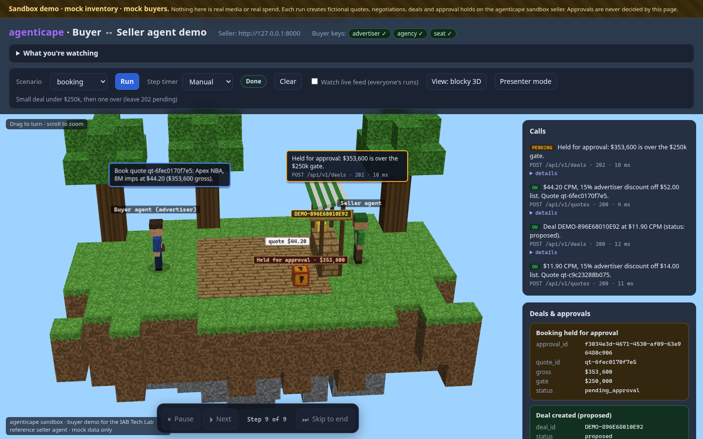
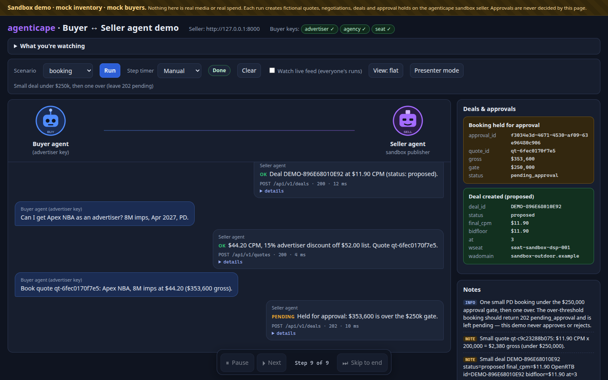
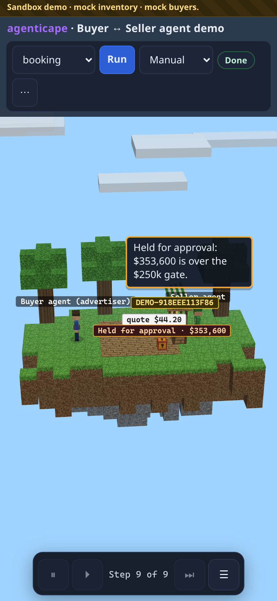
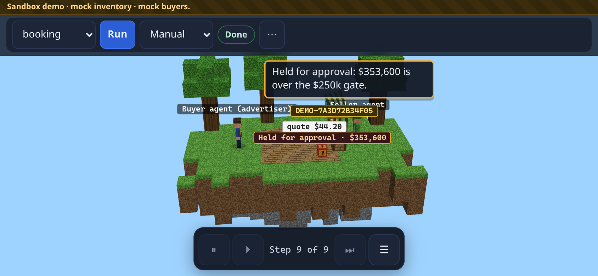

# Buyer-agent demo

A small, standalone buyer that calls a live AAMP seller over REST so you can
see how the seller responds to discovery, pricing, negotiation and booking.

It talks to the public mock-only sandbox at
<https://iab-seller.agenticape.ai> by default (Fly app `iab-seller-agenticape`).
It does **not** use the IAB buyer-agent MCP or A2A clients (those paths failed
against this host in earlier probes). It never approves or rejects seller
approvals, and it never writes API keys to logs or files.

This is mock data only. Do not point it at a real ad server, SSP, or any
environment with real publisher data.

## Quick start

See **[RUN.md](RUN.md)** for env vars (names only), setup, one command per
scenario, and the full suite.

```bash
# In the seller fork this is examples/buyer-demo. On the box: /workspace/buyer-agent.
cd examples/buyer-demo   # or: cd /workspace/buyer-agent
uv sync
export SELLER_URL=https://iab-seller.agenticape.ai
# export KEYS_FILE=../../sandbox/.local/keys.fly.json   (see RUN.md)
# PowerShell: $env:SELLER_URL = "..."; $env:KEYS_FILE = "...\keys.fly.json"

uv run python buyer_demo.py --check          # read-only health check
uv run python buyer_demo.py --scenario discovery
uv run python buyer_demo.py --all            # creates a small deal + a pending approval
uv run python buyer_demo.py --ui             # watch it in the browser (see below)
```

Each run writes a timestamped JSON log and a readable markdown log under
`runs/` (gitignored). Request headers that carry keys are redacted.

## Watch it live (`--ui`)

```powershell
uv run python buyer_demo.py --ui            # opens http://127.0.0.1:8765/
```

A local page shows the buyer agent on the left and the seller agent on the
right. By default they stand on a small blocky 3D island: the buyer in a blue
suit with a briefcase, the seller behind a market stall. A glowing packet arcs
between them for each call, booked deals pop onto the stall as gold blocks,
approval holds appear as padlock blocks, and a refused call gets crossed arms
and a red X. Drag to turn the camera and scroll to zoom. The **View** button
switches to the flat 2D chat view, and the page remembers your choice.
Browsers without WebGL get the flat view automatically.

Each HTTP call becomes a pair of speech bubbles in plain words ("Can I
get Apex NBA as an advertiser? 8M imps, Apr 2027" / "Held for approval:
$353,600 is over the $250k gate"), coloured green (agreed), amber (counter or
held for approval) or red (refused). Under each reply are the method, path,
status and latency, plus a click-to-expand of the raw request and response.
A side panel shows deal and approval cards and the running notes. Pick a
scenario and press **Run**.

The seller answers in milliseconds, so the page plays the run back one step
at a time: the buyer speaks, then the seller replies (with any gold block,
padlock or red X). Set the **Step timer** to 2, 4 (default), 6, 8 or 10
seconds, or to a custom number, or pick **Manual**. Then click or tap anywhere
on the scene (or press Space or →) to go to the next step. The playback bar at
the bottom has Pause/Play (**P**), Next, a "Step 3 of 9" counter with a
countdown line, and **Skip to end**. Clicks on controls, panels and JSON
expanders never advance, and neither does dragging the camera.

It works on phones in portrait and landscape. The controls fold into a
compact bar, the calls, cards and notes open as a bottom sheet (☰), and you
pinch to zoom. **Presenter mode** hides everything except the scene and the
playback bar, and goes fullscreen where the browser allows it. iPhone Safari
has no fullscreen for pages, so there it only hides the chrome.

The page
is plain HTML with no CDN and no build step, so it works offline: three.js r170
is vendored as one file in `static/` (MIT, licence header kept), and all the
block and character textures are drawn procedurally in the browser. Keys never
reach the browser.
The `runs/` logs are written exactly as for the CLI.





 

The same page is hosted for anyone at <https://iab-buyer.agenticape.ai>
(`--serve` mode, with a per-visitor rate limit and a run queue). See
[deploy/fly/DEPLOY.md](deploy/fly/DEPLOY.md).

## What it covers

| Scenario | What it shows |
|---|---|
| `discovery` | Anonymous vs keyed catalog and `POST /discovery` (price ranges vs exact prices, `access_tier`) |
| `pricing` | `POST /pricing` by tier, then a keyed `POST /api/v1/quotes` |
| `negotiation` | A reasonable counter, then a below-floor lowball on a fresh quote (no booking) |
| `booking` | A small deal under the $250k approval gate, then one over (expect `202 pending_approval`, left pending) |
| `anon-write` | Anonymous quotes, bookings and proposals (expect `401`) |
| `extras` | Agent card, `GET /mcp` reachability, media kit, a small proposal (not booked) |

## Safety

- Do not change the seller app, its Fly machine, volume, secrets or config.
- Do not post anything from this demo upstream to IABTechLab.
- Leave any pending approval untouched. This script has no decide/resume calls,
  and its HTTP client refuses any non-GET request under `/approvals`.
